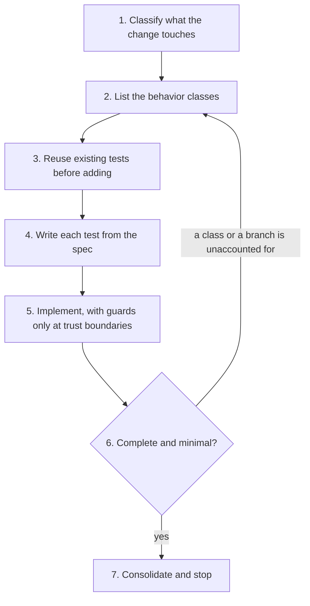

# concord-skill-lean-testing

<p>
<a href="LICENSE"></a>

</p>

**Tests that defend the code without freezing it.**

AI coding agents write tests faster than anyone can read them, and they write too many. They pin config values, mirror the implementation they just wrote, reach into private helpers, and add a guard (and a test for it) for every state they can imagine. Each test passes on the day it is written. Then every retune, refactor or rename turns some of them red, and the fix is always to edit the test. The suite has stopped defending the code and started freezing it.

This skill gives an agent one rule for what a test may assert, a seven-step procedure for planning and writing tests, and a check that tells it when the test set is complete and minimal, so that it knows when to stop.

## What changes

Before: the test repeats a value from the config file.

```python
def test_alert_threshold():
    assert config.ALERT_THRESHOLD == 0.40
```

This test catches nothing, because whoever retunes the threshold also edits the test. It fails on every retune.

After: the test checks the rule, with a threshold that the test chooses.

```python
@pytest.mark.parametrize("score, flagged", [(0.70, True), (0.69, False)])
def test_flags_scores_at_or_above_the_threshold(score, flagged):
    assert classify(score, threshold=0.70) is flagged
```

This test survives any retune, and it still fails if someone writes `>` where the rule says `>=`.

The same rule removes snapshot tests that nobody reviewed, tests of private helpers, mocks of the project's own modules, guards for states that cannot occur, and the reflex of adding a new regression test for every bug when an existing test should have caught it.

## How it works



### The core rule

A failing test tells you something only when its expected value comes from a source with more authority than the code under test. Then the failure means the code is wrong.

| Outranks the code: a test may assert it | Same authority as the code: a test learns nothing from it |
|---|---|
| the spec or the acceptance criteria | config values: thresholds, lists, prompts, model names, version pins |
| a contract that someone else consumes: an API, a schema, a file format | the code's own output, recorded without review |
| a reference implementation | constants copied from the code |
| a mathematical law: round trip, ordering, idempotence | the algorithm re-implemented inside the test |
| a golden file that the spec owner approved | |

When a same-authority test fails, nobody can tell which side is wrong, so the only fix is to make the two agree again.

### The procedure

1. **Classify** each touched part. Logic gets unit tests. A contract gets one contract test per boundary. Config gets no tests on its values; tests inject their own. Quality on real data gets an evaluation with an owner-set metric. Glue gets one integration path. Trivial code gets nothing.
2. **List the behavior classes** for each spec clause, with their boundaries. Each class gets one test. The number of classes sets the test budget; the number of changed lines does not.
3. **Reuse** before you add: keep, extend, replace, merge or delete existing tests. Add a test only for a class that no test covers.
4. **Write** each test before the code, from the spec, through the public interface, with the config built inside the test.
5. **Guard** only where input enters the system. A guard for a state that cannot occur adds a branch, and that branch then asks for a test.
6. **Check** completeness and minimality. When the check holds, stop writing tests.
7. **Consolidate** the tests that the task touched.

### The stopping check

The test set is **complete** when every behavior class has a test, and every branch that the change adds is either reached by a test or has a stated reason: glue, third-party code, logging only, or guaranteed by the type system.

The test set is **minimal** when every test maps to exactly one behavior class, and no test reads production config, asserts a config value or reaches a private symbol.

A changed branch that no requirement asks for is an undecided behavior. The owner decides it, or the code goes. A test would only make it permanent.

## Install

Clone the repository into your Claude Code skills folder:

```bash
git clone https://github.com/bqp007/concord-skill-lean-testing.git ~/.claude/skills/concord-skill-lean-testing
```

Update it with `git -C ~/.claude/skills/concord-skill-lean-testing pull`. If you keep the checkout somewhere else, link it instead:

```bash
ln -s /path/to/concord-skill-lean-testing ~/.claude/skills/concord-skill-lean-testing
```

## Use

Claude Code picks the skill up when a task plans, writes, reviews or consolidates tests, or is about to add a guard or a validation check. You can also ask for it by name.

To make a planner load it at fixed points, add a line like this to your `CLAUDE.md`:

```text
Test plan rows, failing tests and the consolidation pass: load the concord-skill-lean-testing skill first.
```

The skill is a companion to [Concord](https://github.com/bqp007/concord-agent-harness), where a strong model writes the plan and the tests and cheap models write the code. It works the same way without Concord.

## Why these rules

- **A test suite is a filter on changes.** It should reject every change that breaks a promise and accept every change the spec allows: refactors, retunes, performance work, new features, renames and log text. Most over-testing is a filter that rejects allowed changes.
- **Information needs authority.** A test checked against config or against the code's own output can only report that something changed. It cannot report that something is wrong.
- **Completeness and minimality come from two lists.** One list holds the behavior classes that the spec decides. The other holds the branches that the changed code takes. Each class gets one test, and each branch is reached or explained. Anything left over on either side is a finding, not a reason to add a test.
- **Guards cost twice.** Every guard adds a branch, and every branch asks for a test. Validating input once, at the boundary, keeps both the code and the tests small.
- **Coverage percentages reward extra tests.** The stopping check asks that every branch be accounted for, not that a number goes up.

## Limits

- Completeness holds only relative to the behavior classes you listed and the branches you measured. Whether the classes match the real requirement is for the spec and its owner to settle.
- Coverage shows that a branch ran, not that a test checked its result. Mutation testing on the diff shows that, at a much higher cost.

## Sources

- Vladimir Khorikov, *Unit Testing Principles, Practices, and Patterns* (Manning, 2020): the four pillars of a good test, the code-type quadrant, mocks only for unmanaged dependencies.
- Kent Beck, "Test Desiderata" (2019): tests should be behavioral and structure-insensitive.
- Google Testing Blog, "Change-Detector Tests Considered Harmful" (2015).
- Thomas Ostrand and Marc Balcer, "The Category-Partition Method for Specifying and Generating Functional Tests," *Communications of the ACM*, 1988.
- Matthias Grochtmann and Klaus Grimm, "Classification Trees for Partition Testing," *Software Testing, Verification and Reliability*, 1993.
- RTCA DO-178C: modified condition/decision coverage (MC/DC).
- Mary Jean Harrold, Rajiv Gupta and Mary Lou Soffa, "A Methodology for Controlling the Size of a Test Suite," *ACM TOSEM*, 1993.
- Bertrand Meyer, *Object-Oriented Software Construction*, 2nd ed. (1997): Design by Contract and the non-redundancy principle.
- Alexis King, "Parse, Don't Validate" (2019).

## License

MIT. See [LICENSE](LICENSE).
