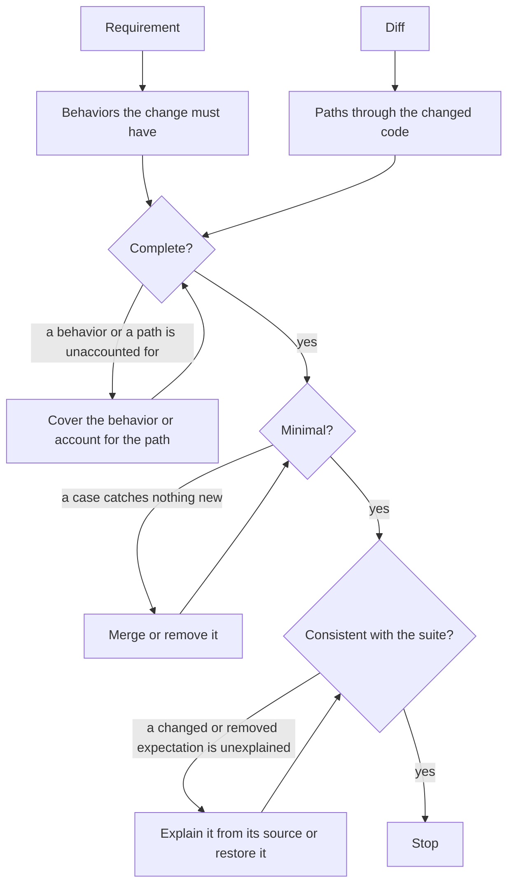
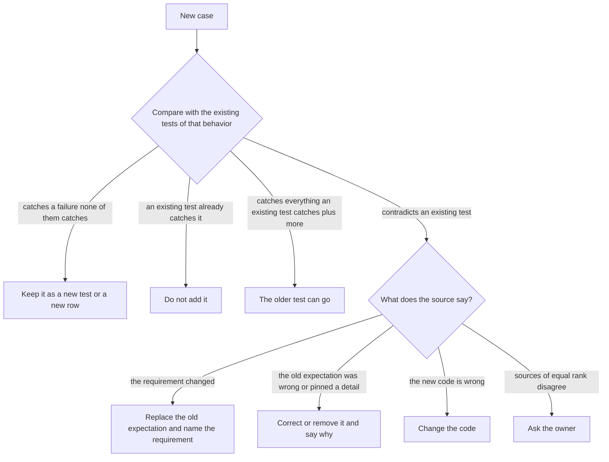

# concord-skill-lean-testing

<p>
<a href="LICENSE"></a>

</p>

**Tests that defend the code without freezing it.**

AI coding agents write tests faster than anyone can read them, and they write too many. They pin config values, mirror the implementation they just wrote, reach into private helpers, and add a guard (and a test for it) for every state they can imagine. Each test passes on the day it is written. Then every retune, refactor or rename turns some of them red, and the fix is always to edit the test. The suite has stopped defending the code and started freezing it.

This skill gives an agent a small set of principles for what a test may assert, and a description of a finished test set, complete and minimal, so that it knows when to stop. It also says how new tests join a suite that already exists: what to do with a duplicate, a weaker old test, a contradiction, or a test that went stale. It prescribes no technique and no test count; how to get there is left to the agent's judgment.

## What changes

Before: the test repeats a value from the config file.

```python
def test_alert_threshold():
    assert config.ALERT_THRESHOLD == 0.40
```

This test catches nothing, because whoever retunes the threshold also edits the test. It fails on every retune.

After: the test checks the rule, with a threshold that the test chooses.

```python
@pytest.mark.parametrize("score, flagged", [(0.69, False), (0.70, True), (0.71, True)])
def test_flags_scores_at_or_above_the_threshold(score, flagged):
    assert classify(score, threshold=0.70) is flagged
```

This test survives any retune. The case at 0.70 fails if someone writes `>` where the rule says `>=`, the case at 0.71 fails for `==`, and the case at 0.69 fails for a rule that flags everything. Two inputs with the same expected result both earn their place, because they catch different failures.

The same rule removes snapshot tests that nobody reviewed, tests of private helpers, mocks of the project's own modules, guards for states that cannot occur, and the reflex of adding a new regression test for every bug when an existing test should have caught it.

## How it works



Each new case is weighed against the tests that already exist:



### The core rule

A failing test signals a mismatch between the code and an expectation. The failure helps only when a source independent of the code can settle which side is wrong.

| Outranks the code: a test may assert it | Same authority as the code: a test learns nothing from it |
|---|---|
| the spec or the acceptance criteria | config values: thresholds, lists, prompts, model names, version pins |
| a contract that someone else consumes: an API, a schema, a file format | the code's own output, recorded without review |
| a reference implementation | constants copied from the code |
| a mathematical law: round trip, ordering, idempotence | the algorithm re-implemented inside the test |
| a golden file that the spec owner approved | |

When a same-authority test fails, nobody can tell which side is wrong, so the only fix is to make the two agree again. An unreviewed snapshot is a change detector, not a test. A reviewed golden file can also go stale, so a failure sends you back to the source to decide whether the code or the test changes.

### The principles

1. **The expected value must outrank the code.** See the table above.
2. **The test set is a filter on changes.** It rejects every change that breaks a promise and accepts every change the spec allows.
3. **Config is not behavior.** No test asserts a tuned value; unit tests inject their own. The production loader validates the shipped files, profile selection and override precedence are tested through the normal entry point, and quality on real data is an evaluation with an owner-set metric.
4. **Test through contracts.** Test behavior through an interface that real callers use and that a refactor leaves alone. A test tied to private symbols or to mocks of your own modules follows how the code is built, not what it promises. The layer is the agent's call.
5. **Guards belong at trust boundaries.** Validate where input enters the system, and enforce invariants on shared state in one atomic step where that state changes. A guard for a state that cannot occur adds a branch, and that branch then asks for a test.
6. **The suite outlives the task.** Each test is a standing claim, and a task changes the set of claims. A new case earns its place only by catching a failure that the existing tests miss. A contradiction is a conflict between requirements, and the source decides whether the code or the test changes. An expectation whose behavior is gone is removed in the same change, and checks for surviving behavior stay. Only the tests of the touched behaviors are maintained, and no test is removed on equal coverage alone.

### What a finished test set shows

The test set is **complete** when every distinct behavior the change must have is covered by at least one assertion that fails when the behavior breaks, and no path through the changed code is left unaccounted for: it is exercised, or you can say where it runs, which invariant prevents it, or what prevents verification. A required behavior that could not be verified is reported as open, not counted as covered.

The test set is **minimal** when every case catches a failure that the rest of the suite would miss, existing tests were reused before new ones were added, and no test asserts a tuned config value or is tied to incidental detail.

The test set is **consistent with the suite** when every expectation whose meaning changed, or that was removed, is explained by its source, no expectation remains for a removed behavior while checks for surviving behavior are kept, and assertions on untouched behaviors are unchanged.

A changed path that introduces an observable behavior no requirement asks for is an undecided behavior. The owner decides it, or the code goes. A test would only make it permanent.

## Install

Clone the repository into your Claude Code skills folder:

```bash
git clone https://github.com/bqp007/concord-skill-lean-testing.git ~/.claude/skills/concord-skill-lean-testing
```

Update it with `git -C ~/.claude/skills/concord-skill-lean-testing pull`. If you keep the checkout somewhere else, link it instead:

```bash
ln -s /path/to/concord-skill-lean-testing ~/.claude/skills/concord-skill-lean-testing
```

## Use

Claude Code picks the skill up when a task plans, writes, reviews or consolidates tests, or is about to add a guard or a validation check. You can also ask for it by name.

To make a planner load it at fixed points, add a line like this to your `CLAUDE.md`:

```text
Test plan rows, failing tests and the consolidation pass: load the concord-skill-lean-testing skill first.
```

The skill is a companion to [Concord](https://github.com/bqp007/concord-agent-harness), where a strong model writes the plan and the tests and cheap models write the code. It works the same way without Concord.

## Why these rules

- **A test suite is a filter on changes.** It should reject every change that breaks a promise and accept every change the spec allows: refactors, retunes, performance work, new features, renames and log text. Most over-testing is a filter that rejects allowed changes.
- **Information needs authority.** A test checked against config or against the code's own output can only report that something changed. It cannot report that something is wrong.
- **Completeness and minimality come from two lists.** One list holds the behaviors that the requirement decides. The other holds the paths through the changed code. Each behavior is covered, each path is exercised or explained, and each case catches a failure the others miss. The size of the suite follows from the behaviors, not from a count fixed in advance.
- **Principles, not procedure.** A capable model does not need a recipe, and a recipe constrains it. The skill says what a good test set is and leaves the method open.
- **A red existing test is evidence, and an edited expectation is a claim.** Refactors, new features and bug fixes should leave sound expectations alone. So an edit to an expectation names the requirement that changed, or explains why the old expectation was unsupported. The alternative, editing tests until they pass, is how a suite stops defending anything.
- **Deleting is maintenance; pruning on coverage is not.** In a study of six Java projects, Pinto, Sinha and Orso found that test repair is only one part of how suites evolve: many apparent additions and deletions were moves or renames, and obsolescence explained most of the failing tests that were deleted. Removing tests because coverage looks equal is different. Comparing coverage alone can flag tests as redundant when they are not (Koochakzadeh and Garousi), and coverage-based minimization has lost detection of seeded faults in some studies (Rothermel et al.).
- **Guards cost twice.** Every guard adds a branch, and every branch asks for a test. Validating input once, at the boundary, keeps both the code and the tests small.
- **Coverage percentages reward extra tests.** The stopping check asks that every path be accounted for, not that a number goes up.

## Limits

- Completeness holds only relative to the behaviors you listed and the paths you examined. Whether the behaviors match the real requirement is for the spec and its owner to settle.
- Coverage shows that a branch ran, not that a test checked its result. Mutation testing on the diff shows that, at a much higher cost.
- Equal coverage alone does not establish that a test is redundant. That takes an argument about the failures each test catches.

## Sources

- Vladimir Khorikov, *Unit Testing Principles, Practices, and Patterns* (Manning, 2020): the four pillars of a good test, the code-type quadrant, mocks only for unmanaged dependencies.
- Kent Beck, "Test Desiderata" (2019): tests should be behavioral and structure-insensitive.
- Google Testing Blog, "Change-Detector Tests Considered Harmful" (2015).
- Thomas Ostrand and Marc Balcer, "The Category-Partition Method for Specifying and Generating Functional Tests," *Communications of the ACM*, 1988.
- Matthias Grochtmann and Klaus Grimm, "Classification Trees for Partition Testing," *Software Testing, Verification and Reliability*, 1993.
- RTCA DO-178C and Hayhurst, Veerhusen, Chilenski and Rierson, *A Practical Tutorial on Modified Condition/Decision Coverage*, NASA/TM-2001-210876 (2001): the formal version of "every condition can change the result", for projects that require it.
- Mary Jean Harrold, Rajiv Gupta and Mary Lou Soffa, "A Methodology for Controlling the Size of a Test Suite," *ACM TOSEM*, 1993.
- Leandro Sales Pinto, Saurabh Sinha and Alessandro Orso, "Understanding Myths and Realities of Test-Suite Evolution," FSE 2012.
- Gregg Rothermel, Mary Jean Harrold, Jeffery Ostrin and Christie Hong, "An Empirical Study of the Effects of Minimization on the Fault Detection Capabilities of Test Suites," ICSM 1998.
- Shin Yoo and Mark Harman, "Regression Testing Minimization, Selection and Prioritization: A Survey," *Software Testing, Verification and Reliability*, 2012.
- Negar Koochakzadeh and Vahid Garousi, "A Tester-Assisted Methodology for Test Redundancy Detection," *Advances in Software Engineering*, 2010.
- Erik Kuefler, "Unit Testing," chapter 12 of Titus Winters, Tom Manshreck and Hyrum Wright (eds.), *Software Engineering at Google* (O'Reilly, 2020): tests that do not change when behavior does not.
- Bertrand Meyer, *Object-Oriented Software Construction*, 2nd ed. (1997): Design by Contract and the non-redundancy principle.
- Alexis King, "Parse, Don't Validate" (2019).

## License

MIT. See [LICENSE](LICENSE).
